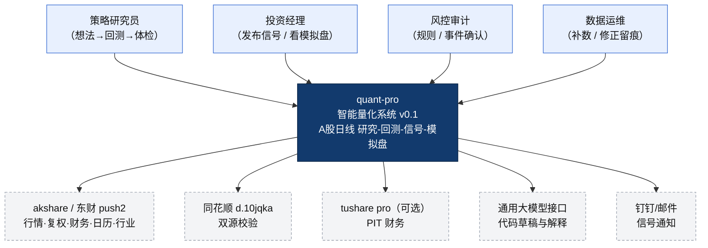
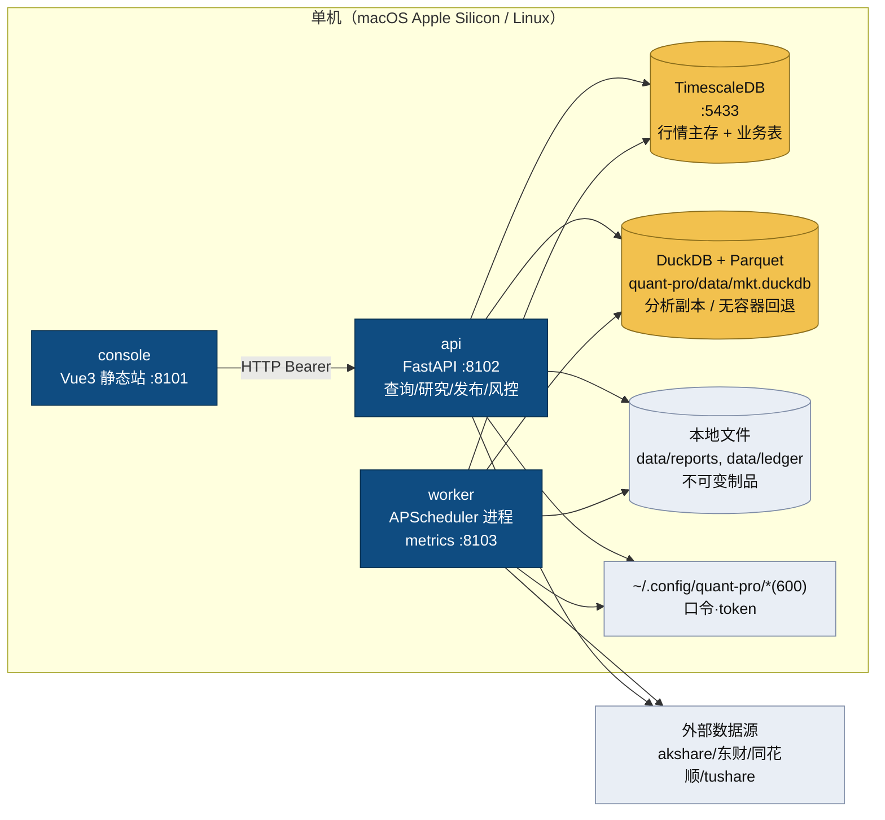
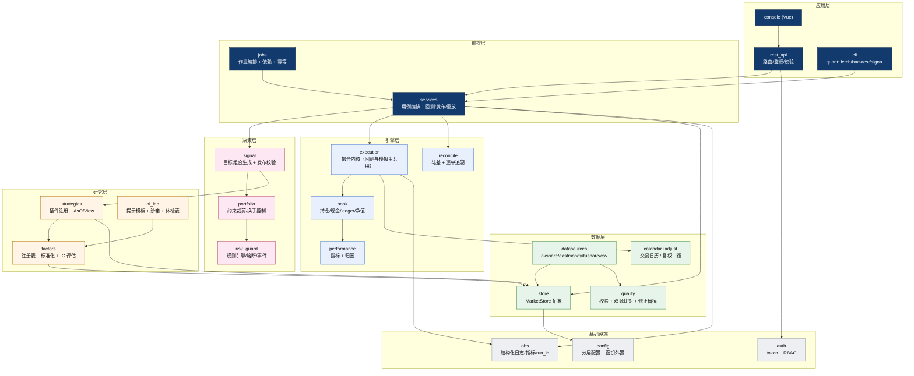
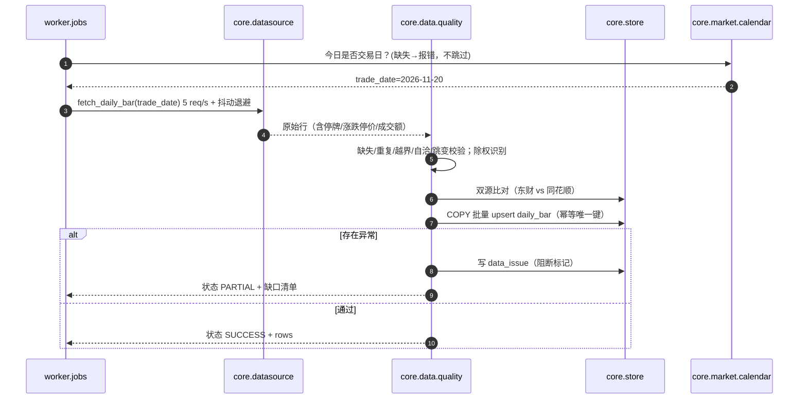
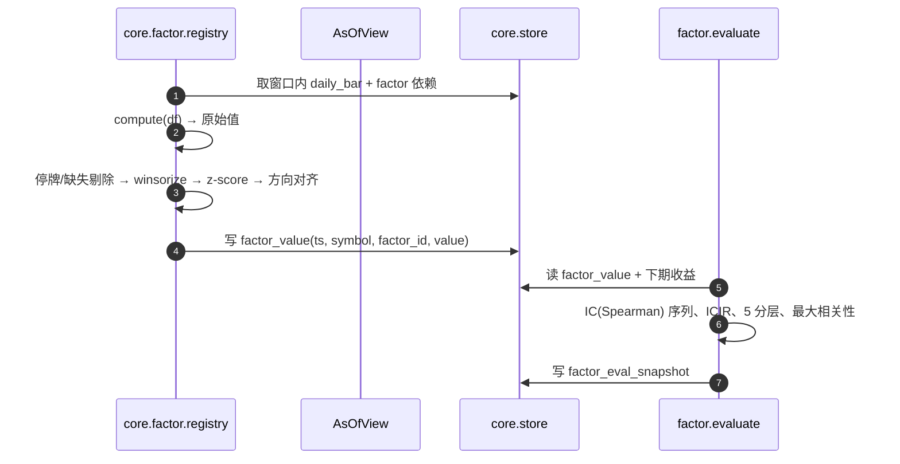
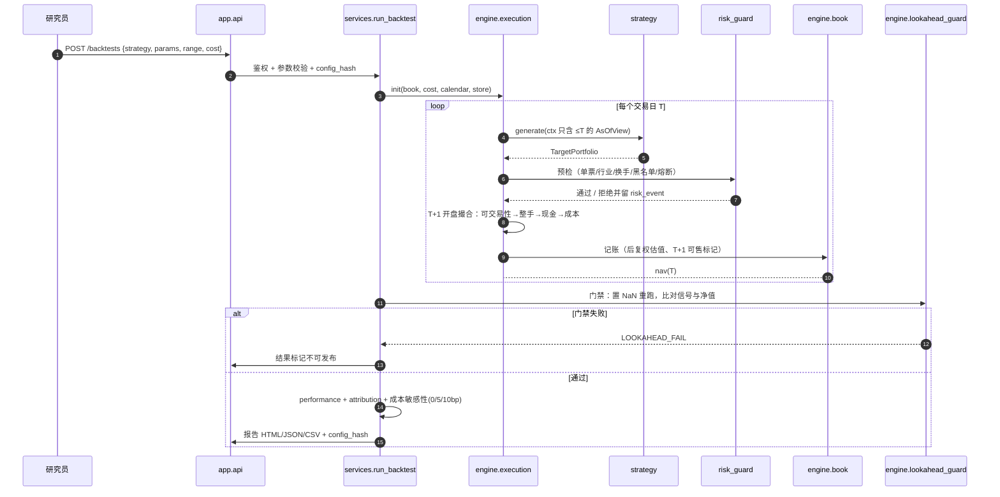
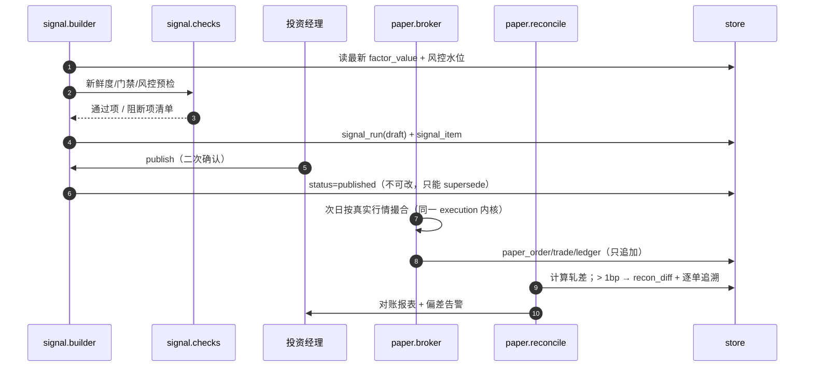
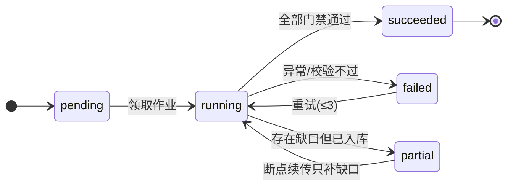
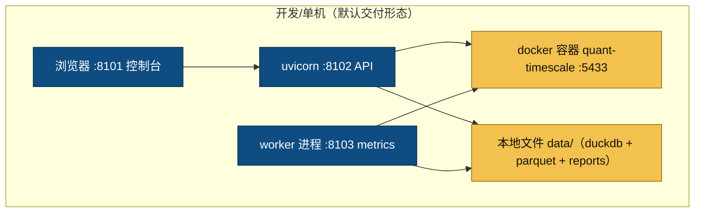

# 智能量化系统 架构设计说明书（ARCHITECTURE）

| 项 | 值 |
|---|---|
| 项目代号 | quant-pro |
| 文档版本 | v0.1（对应 [REQUIREMENTS.md](REQUIREMENTS.md) v0.1） |
| 编制日期 | 2026-11-20 |
| 图规范 | Mermaid（≤8.8.3 语法，classDef 配色，不用 ASCII 图） |
| 下游 | [03 详细设计](DETAILED-DESIGN.md) / [04 测试与验收](TEST-ACCEPTANCE.md) / [05 UI 设计](UI-DESIGN.md) |

---

## 1 架构目标与设计原则

| 编号 | 原则 | 落地点 |
|---|---|---|
| AP-01 | **结论可信优先于结论好看** | 口径集中在 `core/calendar`、`core/adjust`、`core/cost`，任何模块不得自算复权或年化 |
| AP-02 | **禁止未来函数**（结构性防御） | 策略只拿到 `AsOfView`（截至 T 的只读切片），越界访问抛 `LookaheadAccessError`，而非靠 code review |
| AP-03 | **回测与模拟盘同一撮合内核** | `engine/execution` 单一实现，两处注入 |
| AP-04 | **不静默丢弃**：拒单、缺数、风控拒绝一律留痕 | `backtest_order.reject_reason`、`data_issue`、`risk_event`、`job_run.error` |
| AP-05 | **可靠性在服务端** | 风控、发布校验、对账在 API/worker 内完成，前端仅展示 |
| AP-06 | **可复现** | 每次运行落 `config_hash`；随机性只来自显式 seed |
| AP-07 | **开箱即用**：无容器可跑 | 存储抽象 `MarketStore`，Timescale/DuckDB 双实现，启动时探测降级 |
| AP-08 | **数据只追加、修正另记** | ledger 与 `data_amendment` 不可变；重放生成新账本副本 |
| AP-09 | **模块深、接口窄** | 上层只见 `Factor`/`Strategy`/`Broker`/`Store` 四个协议 |
| AP-10 | **与既有六系统隔离** | 独立目录、独立端口、独立库，不共用 MySQL/ZK/Redis |

---

## 2 技术选型

| 关注点 | 选型 | 理由 | 备选与否决原因 |
|---|---|---|---|
| 语言/运行时 | Python 3.12（`~/.local/bin`） | akshare/pandas 生态；系统 3.9 不满足依赖 | Java：量化研究迭代成本高；Go：无因子生态 |
| Web | FastAPI + Uvicorn + Pydantic v2 | 类型化 schema 与 OpenAPI 自动生成，异步 IO 适配抓取 | Flask：手写校验；Django：过重 |
| 计算 | pandas + numpy（向量化），必要时 DuckDB SQL 下推 | 日线规模内存足够，团队可读性最好 | polars：性能好但生态与调试弱，列为可选加速器 |
| 主存 | **TimescaleDB 2.x**（PostgreSQL 协议） | 时序库首选方案；hypertable 分区 + 列压缩 + SQL 表达力，能同时承载业务表 | InfluxDB：无 JOIN，因子/账本关系表难受；MongoDB：关系弱 |
| 本地/回退 | **DuckDB + Parquet** | 单机分析快、零运维，作为无 Docker 降级与分析副本 | SQLite：列存缺失，回测扫描慢 |
| 撮合/账本 | 自研日频内核（Decimal 金额） | 规则细（整手、T+1、一字板、除权），第三方库不可控 | vectorbt/backtrader：口径黑箱，难满足 AP-01/02 |
| 调度 | APScheduler（进程内）+ `job_run` 表 | 单机 EOD 顺序编排足够，零外部依赖 | XXL-Job：与既有项目共享执行器端口已用满（9994–9999），避免争用 |
| 前端 | Vue 3 + Vite + Element Plus + Chart.js + Pinia | 主流中后台栈，商用级；Chart.js 可离线单文件报告 | React：团队既有 Vue 资产更多 |
| 鉴权 | 本地 token（Bearer），角色 RBAC | 与 ride/pp 门禁一致：`/api/**` 必须带登录态 | 无鉴权：不可接受 |
| 图像/报告 | Jinja2 → 静态 HTML（内联 Chart.js） | 可离线打开、可交付 | PDF：中文字体依赖 |

---

## 3 C4-L1 系统上下文



边界声明：`llm` 只接收字段字典与口径约束、只返回代码草稿与自然语言解释；下单金额、阈值、风控豁免不由模型产生（FR-A-05）。系统对券商无任何出向连接。

---

## 4 C4-L2 容器/部署单元



三进程理由：研究回测（CPU 密集、可能几十秒）与 EOD 抓取（IO 密集、长时重试）若与 API 同进程，任一超时即拖垮控制台响应；worker 独立后可单独重启、单独限流，API 只做编排。

---

## 5 C4-L3 组件划分（api/worker 内部）



依赖方向单向向下，禁止反向：`execution` 不认识 HTTP，`factors` 不认识 UI，`store` 不认识策略。横切（obs/config/auth）由基础设施注入，不形成层次。

---

## 6 模块清单（对应代码目录）

```
quant-pro/
├── app/
│   ├── api/               # rest_api, auth 中间件, OpenAPI
│   ├── console/           # Vue3 + Vite + Element Plus
│   ├── cli/               # typer 入口
│   └── worker/            # jobs, APScheduler 定义
├── core/                  # 领域内核（无框架依赖，可单测）
│   ├── datasource/        # akshare.py eastmoney.py tonghuashun.py tushare.py csv.py + base.py
│   ├── data/              # schema.py normalization.py quality.py amendment.py dual_source_diff.py
│   ├── market/            # calendar.py adjust.py tradability.py universe.py
│   ├── factor/            # registry.py base.py standardize.py evaluate.py builtin/*.py
│   ├── strategy/          # registry.py base.py asof_view.py constraints.py builtin/s1_trend.py s2_multifactor.py s3_rotation.py
│   ├── engine/            # execution.py matching.py cost.py accounting.py lookahead_guard.py
│   ├── performance/       # metrics.py attribution.py report.py templates/
│   ├── signal/            # builder.py publish.py checks.py
│   ├── paper/             # broker.py ledger.py reconcile.py replay.py
│   ├── risk/              # rules.py engine.py events.py builtin_rules.yaml
│   ├── store/             # base.py timescale.py duckdb.py router.py migrations/
│   ├── ai_lab/            # prompts.py codegen.py sandbox.py checks.py checklist.py
│   ├── jobs/              # orchestration.py state.py
│   └── obs/               # logging.py metrics.py
├── config/                # settings.example.yaml, risk_rules.example.yaml
├── data/                  # 运行期：parquet 副本、duckdb、reports、logs
├── scripts/               # start.sh bootstrap.sh fetch_backfill.sh verify.sh bench.py
├── tests/                 # unit / integration / e2e / data_correctness / chaos / perf
├── REQUIREMENTS.md ARCHITECTURE.md DETAILED-DESIGN.md TEST-ACCEPTANCE.md README.md COLLABORATION.md
└── pyproject.toml
```

---

## 7 关键数据流

### 7.1 EOD 数据补全与校验



### 7.2 因子计算与评估



### 7.3 回测（含未来函数门禁）



### 7.4 每日信号 → 模拟盘 → 对账



---

## 8 状态机


`backtest_run` / `job_run` / `signal_run` 共享此骨架；`signal_run` 额外 `draft → published → superseded | withdrawn`；`paper_order` 为 `new → precheck_passed | rejected_precheck → submitted → filled | partially_filled | cancelled`，拒单状态为终态并带 `reject_reason`（容量类预检可受理前拒绝，业务类失败必须留痕）。

---

## 9 双存储与降级矩阵

| 场景 | 判定 | 行为 | 影响 |
|---|---|---|---|
| 正常 | Docker 可用且 TimescaleDB 起 | Timescale 主存 + DuckDB 副本（回测前批量导出所需窗口） | 全功能 |
| 无容器 | `docker info` 失败 / 镜像拉取失败 | `store.router` 全量走 DuckDB，`scripts/start.sh` 打印降级横幅 | 全功能，抓取写入慢约 30%，无列压缩 |
| 容器中途挂 | 连接错误重试 3 次 | 已提交事务保留；作业标 PARTIAL，不重复入库；告警 | 当日下游作业延迟 |
| 副本漂移 | 副本 `data_version` ≠ 主存 | 强制重建该窗口副本，不使用陈旧数据 | 回测拒绝启动直到重建 |
| 大区间回测 | 行数 > 阈值 | 分段加载 + 因子结果落库复用 | 内存可控 |

`MarketStore` 是唯一存储出口，SQL 方言差异封装在两个实现内（Timescale 用 `time_bucket`/压缩策略，DuckDB 用 `ASOF JOIN`/Parquet 扫描）；上层代码不得写方言 SQL。

---

## 10 横切关注点

**配置分层**（低→高覆盖）：内置默认 → `config/settings.yaml` → `~/.config/quant-pro/settings.yaml`(600) → 环境变量 → 运行期 `app_config` 表。密钥类（tushare token、DB 口令、通知 webhook）只从 `~/.config/quant-pro/` 与环境变量读取，仓库仅 `.example`；启动校验权限位非 600 时告警。

**日志**：结构化 JSON，字段 `ts/level/run_id/trade_date/module/msg/err`；`run_id` 贯穿 API→svc→engine→store；错误堆栈落 `data/logs/`，计数进 `job_run.error`。禁止把口令写入日志或拼进 argv（异常 traceback 会回显）。

**错误处理**：领域异常分层 `QuantError` → `DataError` / `LookaheadAccessError` / `TradabilityReject` / `CashShort` / `RiskReject` / `ReconDiff` / `StoreUnavailable`。API 层映射错误码表（详细设计 §19），不向外抛裸 500。

**事务与幂等**：行情与因子写入用「批量 COPY → upsert by (ts,symbol,*)」；作业幂等键 = `(job_id, trade_date, attempt_bucket)`；ledger 只追加，冲正用反向记录而非 UPDATE。

**时间**：所有业务时间为 `Asia/Shanghai` 日期；DB 存 `date`（行情）与 `timestamptz`（运维元数据）；年化/日历用交易日历而非自然日。

**鉴权**：token → `principal(user_id, roles)`；`/api/**` 默认拒绝，白名单仅 `/healthz`；RBAC 装饰器 + 资源级校验（如发布需 `role:pm`）。

---

## 11 部署拓扑与端口



| 组件 | 端口 | 与既有项目冲突检查 |
|---|---|---|
| console | 8101 | 空闲（8100 已被 cs-embedding 占用，故顺延） |
| api | 8102 | 空闲 |
| worker metrics | 8103 | 空闲 |
| TimescaleDB | 5433（宿主）→ 5432（容器） | 5432/5433 宿主均空闲；`claim-shared-temporal-db` 的 5432 未发布到宿主 |
| 容器网络 | `quant-net` 独立 bridge | 不复用 `claim-shared-*` 与 payment 泳道 |

生产演进（P3 之后可选）：api/worker 各 2 副本 + TimescaleDB 单主 + 对象存储放报告；本机不做多副本验证，文档留路径不提前实现。

---

## 12 容量与性能估算

| 数据 | 估算 | 依据 |
|---|---|---|
| 全 A 标的 | 约 5400 只（含历史退市） | 沪深两市存量 |
| 交易日 | 2016–2025 约 2430 天 | 年约 243 天 |
| `daily_bar` 行数 | ≈ 730 万（平均在市 3000 只 × 2430） | 上市/退市分布取均值 |
| 首次抓取请求数 | 标的数 × 1 次区间请求 + 财务/因子/日历附加 ≈ 1.2 万次 | 5 req/s → 约 40 分钟（含退避） |
| `factor_value` | 730 万 × 12 因子 ≈ 8800 万行 | 压缩后约 1.5–2 GB（Timescale 列压缩 + 分区） |
| 回测内存 | 单策略窗口全 A 日线 pivot ≈ 730 万 × 8 列 float64 ≈ 0.5 GB | 分段加载可控在 2 GB 内 |
| 回测耗时 | 向量化预筛 + 逐日循环 2430 步 → 目标 ≤ 90 s | 逐日循环是主要成本，撮合按截面 numpy 批处理 |

优化顺序（先测量后动手）：①一次取全窗口 pivot 而非逐日查询；②因子结果落库复用；③Timescale 连续聚合做收益/波动；④必要时 polars/SQL 下推。禁止无基准的提前优化。

---

## 13 架构决策记录（ADR）

| 编号 | 决策 | 背景与备选 | 后果 |
|---|---|---|---|
| ADR-001 | 日线为主、不做盘中 | 范围拍板；分钟数据引入 tick 存储与盘中风控复杂度 | 存储与撮合按日粒度，保留 `bar_freq` 字段但不实现 |
| ADR-002 | TimescaleDB 为主存，DuckDB 为副本与回退 | 用户选时序库；Influx 无 JOIN 不利因子/账本 | 双实现成本 + 一致性校验需求，换取开箱即用 |
| ADR-003 | 自研撮合内核 | backtrader/vectorbt 口径黑箱，无法通过 FR-B-13 门禁 | 撮合必须自带完整测试集；换来可审计与可复现 |
| ADR-004 | 净值用后复权、可交易性与整手用真实价 | 前复权含未来信息 | 除权日处理集中在 `adjust`/`tradability`，展示层另算 |
| ADR-014 | **账本统一记在复权单位**，真实价仅用于整手/可交易性/可负担股数；不设单独分红入账 | 东财后复权是差额法（`hfq≈a+b·raw`），按「市值×(r_adj−r_price) 计提分红」的等比法思路不成立，实测净值偏离 ~2pp；而完全用真实价记账会在送转日腰斩 | 现金与费用单位是「复权元」，与真实元有比例差（最低 5 元佣金等绝对额规则近似失真）；已在 §4/§6.2 与 `selftest` 固化口径与断言 |
| ADR-005 | T 日信号、T+1 开盘成交 | 消除收盘价可成交幻觉 | 需开盘价数据；一字板判定用开盘价 |
| ADR-006 | 拒绝全样本网格寻优，改 walk-forward | P-04 过拟合 | 参数稳定性报表成为发布前置条件 |
| ADR-007 | 回测与模拟盘共用 execution | P-05 漂移 | 撮合代码变更同时影响两处，须双跑回归 |
| ADR-008 | APScheduler 进程内调度 | XXL 执行器端口 9994–9999 已用满 | 无分布式调度；跨机调度留作后续（可迁移 XXL） |
| ADR-009 | 实盘以 `LiveBroker` 适配器预留 | v0.1 不做实盘 | 账本/风控接口不得假设只服务回测 |
| ADR-010 | LLM 只产代码与解释，不进资金链路 | 可审计与合规 | 沙箱 + 人工注册双门禁，代价是研究自动化有限 |
| ADR-011 | api 与 worker 分进程 | 抓取长任务与回测 CPU 竞争 | 部署多一个进程，换来响应稳定与独立重启 |
| ADR-012 | 与既有六系统网络/存储隔离 | 并行会话共改工作区 | 独立端口与库；跨系统联动走 HTTP 且须带登录态 |
| ADR-013 | 数据修正另记不可变 | 数据保护规则 | 查询需带修正合并逻辑，禁止直接 UPDATE 行情 |
| ADR-014 | 账本记在复权单位；真实价仅用于整手/可交易性/可负担股数 | 东财后复权为差额法，等比法分红计提不成立（实测净值偏离 ~2pp） | 现金/费用单位为「复权元」，绝对额规则（最低 5 元）近似失真，已固化断言 |
| ADR-015 | API 进程内 DuckDB 单连接 + 每操作 cursor + RLock | 同进程同文件多连接报 ResourceInUse；并发请求曾 500 | 长回测会串行阻塞其他请求；后续可改读写分离或任务队列 |
| ADR-016 | 控制台用 Vue3 全局构建 + Element Plus 本地 vendored，免 npm 构建 | 开箱即用、离线可用；Vite 构建链引入 node 依赖 | 与 UI-DESIGN 的 Vite 方案偏差已记录；版式令牌共用 tokens.css |

---

## 14 演进路径

| 版本 | 新增 | 架构影响 |
|---|---|---|
| v0.1 P1 | 数据+因子+回测+报告（CLI/HTML） | `core` 全部；无 api/console |
| v0.1 P2 | api/console/信号/模拟盘/风控 | 新增应用层与 worker；`store` 加事务与迁移 |
| v0.1 P3 | AI 研究台 + 调度告警 + 体检表门禁 | 新增 `ai_lab`，沙箱独立进程 |
| v0.2 | 分钟频与盘中风控 | 引入 tick 存储、事件队列（可复用 RocketMQ 9876 需另行申请）、撮合内核加多档时间粒度 |
| v0.3 | 实盘网关 | 实现 `LiveBroker`，加订单状态推送与断线重连；账本已就绪 |
| v0.4 | 多策略资金分配 | `portfolio` 层上层加 allocator；风控加账户级约束 |

---

## 15 架构验收要点（映射到 04 文档）

AP-01 → TC-B-01/02（复权与年化口径）；AP-02 → TC-B-20~24（未来函数专项）；AP-03 → TC-P-01~04（回测/模拟盘同结果）；AP-04 → TC-B-08/TC-D-07/TC-R-03（拒单与留痕）；AP-05 → TC-R-08（绕过 UI 直接下单被服务端拒）；AP-06 → TC-B-15（同 config_hash 重跑逐字节一致）；AP-07 → TC-O-06（无 Docker 降级仍跑通）；AP-08 → TC-D-09/TC-P-09（修正与重放不改原数据）。
